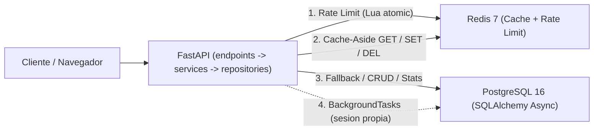
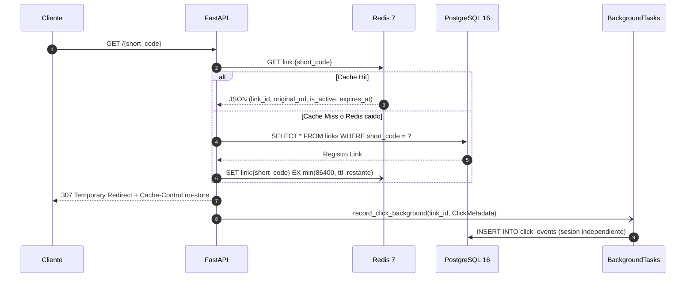

# shortlink-analytics-api

Servicio backend de alto rendimiento para acortamiento de URLs, redirecciones `HTTP 307` de baja latencia mediante **Redis Cache-Aside**, control de tráfico distribuido (**Rate Limiting atómico con Lua**) y telemetría de clics procesada de forma asíncrona en segundo plano sobre **PostgreSQL 16**.

---

## Stack Tecnológico

| Capa | Tecnología | Uso principal |
| :--- | :--- | :--- |
| **API & Runtime** | Python 3.12+, FastAPI, Pydantic v2, `pydantic-settings` | Endpoints REST async, validación estricta y configuración tipada |
| **Base de Datos** | PostgreSQL 16, SQLAlchemy 2.0 (`asyncpg`), Alembic | Persistencia relacional async, pools de conexión y migraciones reversibles |
| **Caché & Rate Limit** | Redis 7 (`redis.asyncio`) | Patrón Cache-Aside (`link:{short_code}`) y ventana fija atómica vía Lua |
| **Seguridad** | `pwdlib[argon2]`, `PyJWT`, HMAC-SHA256 | Hashing Argon2id, tokens JWT Bearer y anonimización de IPs con salt |
| **Analíticas** | FastAPI `BackgroundTasks`, `user-agents` | Telemetría off-request sin sumar latencia a las redirecciones |
| **Calidad & CI** | Pytest, `pytest-asyncio`, `httpx`, Ruff, GitHub Actions | Pruebas async end-to-end, linting/formateo y pipeline automatizado |
| **Infraestructura** | Docker, Docker Compose | Entorno reproducible multi-servicio (API + PostgreSQL 16 + Redis 7) |

---

## Arquitectura del Sistema

El proyecto sigue una arquitectura limpia en capas (`endpoints -> services -> repositories`) desacoplando reglas de negocio, acceso a datos y manejo de caché.



### Flujo de Redirección (`GET /{short_code}`)



---

## Decisiones de Ingeniería

- **`HTTP 307 Temporary Redirect` + `Cache-Control: no-store` en vez de `HTTP 301`:** `301` indica al navegador cachear permanentemente el destino, impidiendo futuras visitas al servidor y dejando ciegas las analíticas. `307` obliga a pasar por la API en cada clic y preserva el método HTTP original.
- **Cache-Aside con invalidación post-`commit()` y degradación elegante:** Si Redis falla (`RedisError`), la API registra un `WARNING` y consulta PostgreSQL directamente sin devolver error `500`. Las operaciones `PATCH` y `DELETE` invalidan `link:{short_code}` **después** de confirmar el `commit()` en PostgreSQL para evitar *stale cache*. Al incluir `link_id` en el payload de Redis, un *Cache Hit* registra métricas sin consultar la BD.
- **Rate Limiting atómico con script Lua en Redis:** Ejecutar `INCR` y `EXPIRE` por separado introduce condiciones de carrera si falla la red entre ambos comandos. Un script Lua ejecuta el incremento, fija el TTL solo en el primer acceso y retorna `{current, ttl}` en un único *round-trip* (`10 req/min` anónimo por IP, `30 req/min` autenticado por `user_id`), respondiendo `HTTP 429` con cabecera `Retry-After` y aplicando política *fail-open* si Redis cae.
- **Analíticas sin bloqueo y ruta de escalado:** `extract_click_metadata` captura y anonimiza los metadatos en memoria antes de responder; `record_click_background` abre su propia `AsyncSession` desde `session_factory` sin reutilizar la sesión del request. Para escalar a miles de clics por segundo, este punto se reemplaza por publicación hacia **Redis Streams / Kafka** y *batch inserts* en workers (*Arq* / *Celery*).
- **Seguridad y privacidad por diseño:** Contraseñas con **Argon2id**, JWT con `sub`/`iat`/`exp`/`type`, IPs anonimizadas con **HMAC-SHA256 + salt** (`IP_HASH_SALT`), generación Base62 criptográfica (`secrets.choice`, 7 caracteres) con reintentos sobre `savepoint` (`begin_nested()`) ante `IntegrityError`, bloqueo de esquemas peligrosos (`javascript:`, `data:`, `file:`, `vbscript:`) y bucles al propio `BASE_URL`, y sobre JSON estandarizado de errores sin exponer stack traces.
- **Diseño PostgreSQL 16:** Clave primaria `BIGSERIAL` en `click_events`, fechas `TIMESTAMPTZ` en UTC e índices compuestos explícitos `ix_links_user_id_created_at (user_id, created_at DESC)` e `ix_click_events_link_id_clicked_at (link_id, clicked_at DESC)`.

---

## Estructura del Proyecto

```text
shortlink-analytics-api/
├── .github/workflows/ci.yml        # CI: Ruff + Alembic upgrade/downgrade + Pytest (PG 16 + Redis 7)
├── alembic/
│   ├── versions/
│   │   ├── 0001_create_users_and_links.py
│   │   └── 0002_create_click_events.py
│   └── env.py
├── app/
│   ├── api/
│   │   ├── deps.py
│   │   └── v1/
│   │       ├── endpoints/
│   │       │   ├── auth.py
│   │       │   ├── health.py
│   │       │   ├── links.py
│   │       │   ├── redirect.py
│   │       │   └── ui.py
│   │       └── router.py
│   ├── core/
│   │   ├── config.py
│   │   ├── database.py
│   │   ├── exceptions.py
│   │   ├── rate_limit.py
│   │   ├── redis.py
│   │   └── security.py
│   ├── models/
│   │   ├── click_event.py
│   │   ├── link.py
│   │   └── user.py
│   ├── repositories/
│   │   ├── click_repository.py
│   │   ├── link_repository.py
│   │   └── user_repository.py
│   ├── schemas/
│   │   ├── analytics.py
│   │   ├── auth.py
│   │   ├── common.py
│   │   └── link.py
│   ├── services/
│   │   ├── analytics_service.py
│   │   ├── auth_service.py
│   │   └── link_service.py
│   ├── static/
│   │   ├── css/styles.css
│   │   ├── js/
│   │   │   ├── api.js
│   │   │   ├── app.js
│   │   │   ├── charts.js
│   │   │   └── ui.js
│   │   ├── favicon.svg
│   │   └── index.html
│   └── main.py
├── tests/
│   ├── conftest.py
│   ├── test_analytics.py
│   ├── test_auth.py
│   ├── test_health.py
│   ├── test_links.py
│   ├── test_rate_limit.py
│   ├── test_redirect_cache.py
│   └── test_ui.py
├── .env.example
├── .gitignore
├── alembic.ini
├── Dockerfile
├── docker-compose.yml
├── pyproject.toml
├── render.yaml
└── scripts/
    └── entrypoint.sh
```

---

## Guía de Arranque Rápido

### 1. Con Docker Compose (Entorno completo)

```bash
cp .env.example .env
# Genera secretos seguros y actualiza POSTGRES_PASSWORD, DATABASE_URL, JWT_SECRET_KEY e IP_HASH_SALT en .env
openssl rand -hex 32

docker compose up -d --build
docker compose exec api alembic upgrade head
curl -i http://localhost:8000/health
```

Interfaz Web (Dashboard) disponible en `http://localhost:8000/` y documentación interactiva en `http://localhost:8000/docs` (Swagger UI) y `http://localhost:8000/redoc`.

### 2. Entorno local de desarrollo y pruebas

```bash
python3 -m venv .venv
.venv/bin/pip install --upgrade pip
.venv/bin/pip install -e ".[dev]"

.venv/bin/ruff check app tests alembic
.venv/bin/ruff format --check app tests alembic
.venv/bin/pytest -v
```

> [!NOTE]
> Por defecto `tests/conftest.py` utiliza SQLite en memoria (`aiosqlite`) y un doble en memoria de Redis para ejecutar la suite sin dependencias externas. Para probar contra servicios reales de PostgreSQL 16 y Redis 7, define `TEST_DATABASE_URL` y `TEST_REDIS_URL` antes de ejecutar `pytest -v` (como ocurre en `.github/workflows/ci.yml`).

### 3. Despliegue en Producción (Render Blueprint — 1 clic)

[](https://render.com/deploy?repo=https://github.com/Brian-Dza/shortlink-analytics-api)

El archivo `render.yaml` aprovisiona automáticamente el servicio web Docker (API + Dashboard), **PostgreSQL 16** y **Redis (Key Value)** con red interna, secretos autogenerados (`JWT_SECRET_KEY`, `IP_HASH_SALT`), ejecución automática de `alembic upgrade head` al iniciar mediante `scripts/entrypoint.sh` y detección automática de `BASE_URL` vía `RENDER_EXTERNAL_URL`.

---

## Contrato de API REST

| Método | Ruta | Auth | Descripción | Código Éxito |
| :--- | :--- | :--- | :--- | :--- |
| `GET` | `/health` | Pública | Ping concurrente a PostgreSQL y Redis | `200 OK` / `503` |
| `POST` | `/api/v1/auth/register` | Pública | Registro de usuario con Argon2id | `201 Created` |
| `POST` | `/api/v1/auth/login` | Pública | Autenticación y emisión de JWT Bearer | `200 OK` |
| `POST` | `/api/v1/links` | Opcional / JWT | Crea enlace Base62 (7 chars) o `custom_alias` + Rate Limit | `201 Created` |
| `GET` | `/api/v1/links` | JWT | Listado paginado (`page`, `page_size`, `is_active`) | `200 OK` |
| `GET` | `/api/v1/links/{short_code}/stats` | JWT (Dueño) | Analíticas agregadas (`days=7` o `days=30`) | `200 OK` |
| `PATCH` | `/api/v1/links/{short_code}` | JWT (Dueño) | Actualiza URL/estado/expiración e invalida caché Redis | `200 OK` |
| `DELETE` | `/api/v1/links/{short_code}` | JWT (Dueño) | Elimina enlace (y clics en cascada) e invalida caché Redis | `204 No Content` |
| `GET` | `/{short_code}` | Pública | Redirección `307` (Cache-Aside) + telemetría background | `307 Temp Redirect` |

### Ejemplos rápidos con `curl`

```bash
# 1. Registro y login
curl -s -X POST http://localhost:8000/api/v1/auth/register \
  -H "Content-Type: application/json" \
  -d '{"email":"dev@example.com","password":"StrongPassword123!"}'

TOKEN=$(curl -s -X POST http://localhost:8000/api/v1/auth/login \
  -H "Content-Type: application/json" \
  -d '{"email":"dev@example.com","password":"StrongPassword123!"}' | python3 -c "import sys,json; print(json.load(sys.stdin)['access_token'])")

# 2. Crear enlace corto autenticado
curl -s -X POST http://localhost:8000/api/v1/links \
  -H "Authorization: Bearer $TOKEN" \
  -H "Content-Type: application/json" \
  -d '{"original_url":"https://fastapi.tiangolo.com/","custom_alias":"fastapi"}'

# 3. Verificar redirección HTTP 307
curl -i http://localhost:8000/fastapi

# 4. Consultar métricas agregadas
curl -s "http://localhost:8000/api/v1/links/fastapi/stats?days=7" \
  -H "Authorization: Bearer $TOKEN"
```

### Formato Estandarizado de Errores

Todas las respuestas de error devuelven un sobre JSON consistente sin exponer stack traces:

```json
{
  "error": {
    "code": "LINK_NOT_FOUND",
    "message": "The requested short link does not exist.",
    "timestamp": "2026-11-23T22:47:38Z"
  }
}
```
